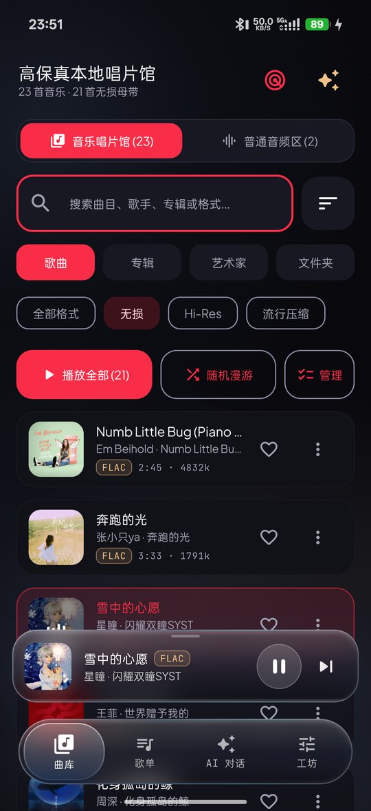
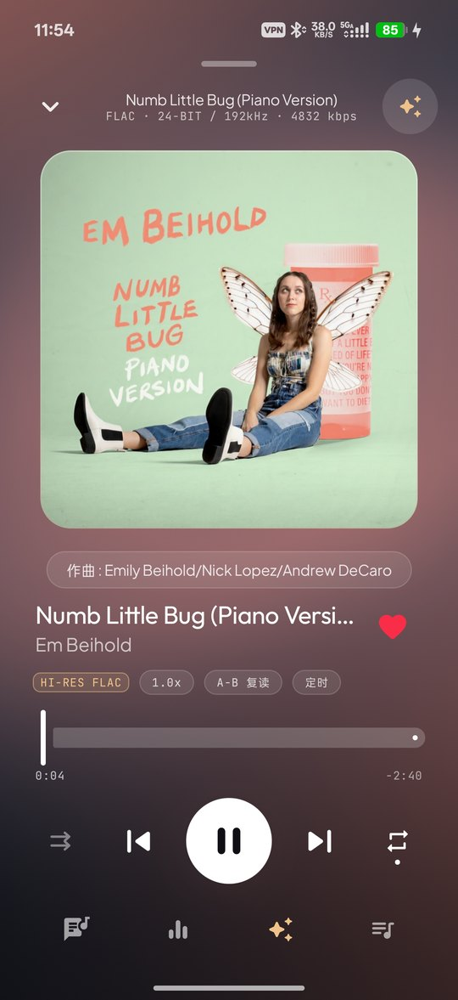
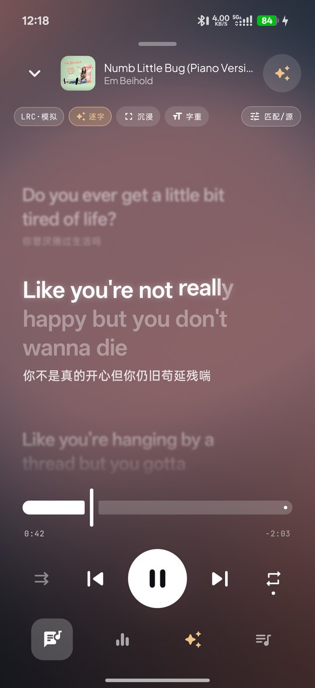
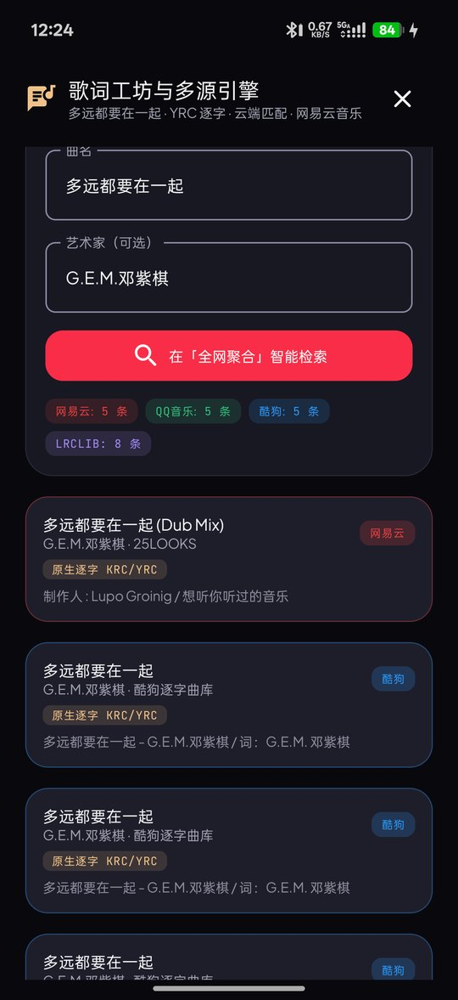
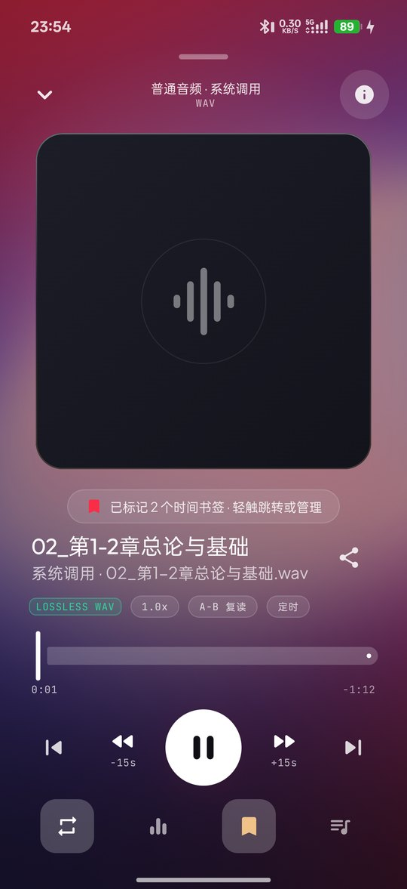
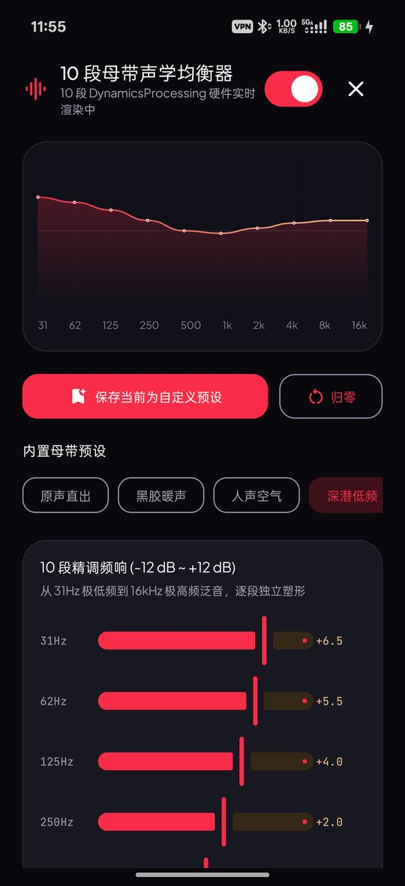
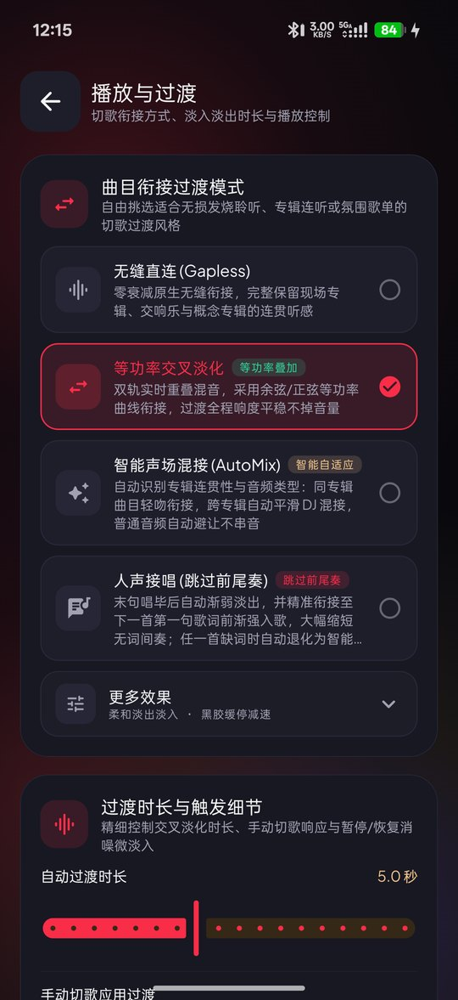
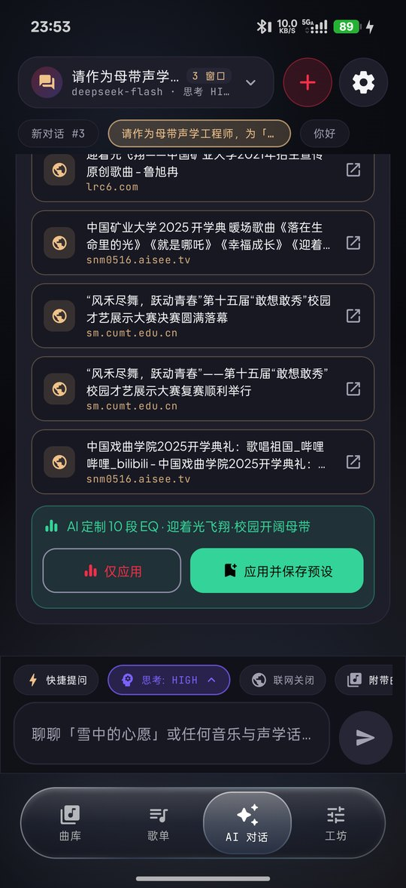

# Auralis

**高保真本地音频整理与 AI 声学播放器（Android）**

> 中国矿业大学首届“智核杯”AI 创作大赛 · **赛道三：AI 实用作品赛道**参赛作品  
> 参赛队名：`DeepSleep`　｜　队长：林恒（09245213）　｜　当前正式版本：**`v1.0.3` (`Build 3`)**

在日常学习与课余生活中，学生经常会接触到大量本地音频文件（课堂与复习录音、外语听力、播客讲座以及个人珍藏的无损音乐）。为了更好地分类整理这些音频并全面提升离线收听体验，本项目与 AI Agent 深度协作，从零构建了一款**纯本地、离线优先、无账号体系**的 Android 高保真音频应用 **Auralis**。

---

## 快速下载与体验

- **最新正式版 Release（`v1.0.3`）**：https://github.com/muge-heng/auralis-player/releases/tag/v1.0.3
- **已签名 APK 安装直链**：https://github.com/muge-heng/auralis-player/releases/download/v1.0.3/Auralis-v1.0.3.apk
- **全部公开版本与迭代历史（`v0.9.0` 起）**：https://github.com/muge-heng/auralis-player/releases
- **运行要求**：Android 7.0+（`minSdk = 24`，`targetSdk = 36`，实测 Android 17 真机流畅运行）

> 首次安装完成 4 页引导后，可按需逐项授权本地音频读取与媒体通知权限，也可直接点击「暂不授权，直接进入」通过系统文件选择器（SAF）零权限导入单曲或整个文件夹。

---

## 界面实拍预览

<table>
  <tr>
    <td align="center" width="25%">
      <br/>
      <sub><b>高保真本地唱片馆</b><br/>双分区隔离 · Liquid Glass 底栏</sub>
    </td>
    <td align="center" width="25%">
      <br/>
      <sub><b>Hi-Res 流体光影舞台</b><br/>24-bit/192kHz · 3D 滑切</sub>
    </td>
    <td align="center" width="25%">
      <br/>
      <sub><b>双语逐字歌词舞台</b><br/>逐字扫光 · 非本行景深模糊</sub>
    </td>
    <td align="center" width="25%">
      <br/>
      <sub><b>四源并发云端搜词</b><br/>网易云 / QQ / 酷狗 / LRCLIB</sub>
    </td>
  </tr>
  <tr>
    <td align="center" width="25%">
      <br/>
      <sub><b>普通音频学习模式</b><br/>±15s 跳播 · 3.0x 倍速 · 书签</sub>
    </td>
    <td align="center" width="25%">
      <br/>
      <sub><b>10 段硬件均衡器</b><br/>低延迟 DSP · 母带预设</sub>
    </td>
    <td align="center" width="25%">
      <br/>
      <sub><b>真双轨智能过渡</b><br/>5.0s 交叉淡化 · 人声接唱</sub>
    </td>
    <td align="center" width="25%">
      <br/>
      <sub><b>AI 声学对话工作台</b><br/>DeepSeek 联网检索 · 一键 EQ</sub>
    </td>
  </tr>
</table>

---

## 核心特性

### 1. 高保真本地唱片馆与「普通音频区」智能分流
- 原生解析 **FLAC / WAV / ALAC / MP3 / M4A / OGG** 采样率、位深、码率、内嵌封面与元数据，清晰区分 **Hi-Res 母带** 与 **Lossless 无损** 规格。
- **音乐与学习音频物理隔离**：自动将缺乏完整音乐元数据的课程录音、播客、听力音频分流至独立「普通音频区」，不混入音乐歌单与 AI 策展；支持随时一键互转分区。
- **普通音频专属学习播放模式**：提供 `±15 秒` 快进快退、`0.5x – 3.0x` 扩展倍速、A-B 复读、持久化时间书签与文件信息检查器。
- **严苛扫描筛选与智能去重**：支持对称 9 档时长上下双界线、最小体积、屏蔽目录与严格 AND 逻辑「仅筛选含有效内嵌封面」校验；导入时自动跳过同音质重复并针对不同音质弹出高品质保留决策。
- **动态智能排序与非破坏性曲目编辑**：综合红心喜爱、听歌频次、近期防腻冷却与艺人防扎堆算法；支持应用内安全修改标题、艺术家、专辑与封面且绝不改动原始音频文件，可随时一键还原。

### 2. 四源并发逐字歌词舞台与无损标签刻录
- 支持 `.yrc` / `.qrc` / `.krc` / `.lrc` / `.ttml` / `.srt` 多格式解析，普通逐行歌词支持智能模拟逐字扫光。
- 聚合 **网易云音乐（含双语/YRC）、QQ 音乐（含双语）、酷狗音乐（原生逐字 KRC）、LRCLIB** 四源并发在线搜词，一键匹配并支持时间轴 `±0.2s` 校准。
- **无损刻录歌词到原音频文件**：自研字节级标签写入器，支持将歌词直接无损写入 MP3（ID3v2 `USLT`）、FLAC（Vorbis `LYRICS`）与 M4A/MP4（`©lyr` 并精确重算 `stco` 偏移），原始音频流零重编码，也支持按原格式导出歌词文件。
- 配备 Apple 风格非本行渐进景深模糊、前奏/间奏三点呼吸指示器、300–900 字重滑块、6 档字号、全屏沉浸模式与**歌词灵动弹性波浪**（`v1.0.3` 默认开启）。

### 3. 真双路 Deck A/B 热切换与「人声接唱」过渡引擎
- 底层采用双 ExoPlayer 实例（Deck A / Deck B 共享 `audioSessionId` 与服务级 `AudioFocus`），提前预解码下一首曲目实现 0ms 顿挫无缝接管。
- 内置 6 种过渡模式：**等功率交叉淡化**（`v1.0.3` 默认 `5.0 秒`）、**人声接唱（跳过前尾奏）**、**智能声场混接（AutoMix）**、**无缝直连（Gapless）**、**柔和淡出淡入**与**黑胶缓停过渡**。

### 4. 10 段硬件级声学均衡器（抗高码率卡顿架构）
- API 28+ 原生采用低延迟时间分辨率管线（`DynamicsProcessing.VARIANT_FAVOR_TIME_RESOLUTION`），内置 8 组母带预设并支持保存无限自定义预设。
- 配备自动前级余量补偿（Auto Preamp Headroom）、安全限幅器、按需惰性挂载 `BassBoost`/`Virtualizer` 与扩展 PCM `AudioTrack` 缓冲池（`500ms–1200ms × 4`），实测播放 24-bit/192kHz FLAC 开启高增益预设全程 `Underruns = 0`。

### 5. DeepSeek 原生联网思考与 AI 声学对话工作台
- 适配 DeepSeek 官方原生 Anthropic Messages API（`/anthropic/v1/messages`），打通 `deepseek_web_search` 与 `deepseek_read_url` 多步边思考边联网检索，支持 `reasoning_effort` 多档思考强度滑块与多窗口独立对话。
- 支持附带当前播放曲目、专辑封面视觉分析（Vision）、记忆式勾选本地曲库清单与逐首歌词；支持 **AI 策展一键建歌单** 与 **AI 定制 10 段 EQ 卡片一键应用/保存**。
- 完整渲染 Markdown GFM 表格、矢量图标检索轨迹卡片与系统浏览器可点击参考来源；支持兼容任意 OpenAI 协议网关并预留 Gemini 接口。

### 6. 全透明 Liquid Glass 美学与本地数据安全
- 自绘零闪屏启动动效、曜石深色与云白浅色双主题、可按住左右拖动跟手切页的 **Liquid Glass 悬浮底栏**、以及 Android 13+ AGSL 液态玻璃折射与流体极光着色器（`v1.0.3` 默认开启视觉效果增强）。
- 支持脱敏 JSON 本地设置备份与预览恢复、全局双模式防误删保护（二次确认 / 6 秒置顶可撤销条）、四档二次确认危险区数据清理（绝不删除手机本地原文件，清除曲库索引后重导入可自动恢复播放热度与红心收藏）以及国产安卓 ROM 默认音频播放器直达路由。

---

## 技术架构

| 层次 | 关键技术与核心模块 |
| :--- | :--- |
| **UI 与动效层** | Kotlin 2.4 · Jetpack Compose · Material 3 · AGSL `RuntimeShader` · `MotionModifiers`（含全屏触控防穿透屏障 `blockUnderlyingTouches()`） |
| **音频与 DSP 层** | AndroidX Media3 (`ExoPlayer` / `MediaSessionService`) · `AuralisPlaybackService`（真双路 Deck A/B）· `AcousticDspEngine`（10 段 `DynamicsProcessing`） |
| **持久化与扫描层** | Room Database · Jetpack DataStore Preferences · `LocalMusicScanner` · `MetadataExtractor` · `TrackDeduplicator` · `SettingsBackupCodec` |
| **歌词与标签层** | `LyricParser`（YRC/QRC/KRC/LRC/TTML/SRT）· `OnlineLyricClient`（四源并发）· `AudioLyricsTagWriter`（MP3/FLAC/MP4 字节级无损写入） |
| **AI 协议层** | OkHttp SSE Streaming · Moshi · `DeepSeekChatClient`（原生 Messages API `pause_turn` 联网思考状态机）· `MarkdownText` |
| **自动化构建** | Gradle 9.3.1 · AGP 9.1.1 · JDK 21 · GitHub Actions（`.github/workflows/build-apk.yml` 自动签名打包）· JUnit 4 + Robolectric 单元测试 |

---

## 本地构建与测试

```bash
# 运行本地单元测试（含歌词解析、音频标签写入、智能排序、过渡曲线、AI 协议流与默认配置校验）
gradle :app:testDebugUnitTest

# 构建 Debug APK
gradle :app:assembleDebug

# 构建签名 Release APK（需通过环境变量提供签名证书）
# KEYSTORE_PATH=... STORE_PASSWORD=... KEY_PASSWORD=... gradle :app:assembleRelease
```

---

## 版本迭代说明

本项目研发分为两个连续阶段：
1. **早期平台孵化阶段（`v0.9.0` 之前，共 12 轮连续迭代）**：在 Google AI Studio（Android Studio Agent）中通过内置检查点完成从 0 到 1 架构搭建、真机止崩、四源搜词、10 段 EQ、普通音频分区、导入查重与 DeepSeek 原生联网思考协议打通。
2. **GitHub 公开维护阶段（`v0.9.0 → v1.0.3`，共 14 个公开版本）**：第 12 轮成型后正式推送至本仓库并追认为 `v0.9.0`，此后所有迭代均在 GitHub 公开提交并持续发布签名 APK。

| 版本 | 构建号 | 核心演进摘要 |
| :--- | :--- | :--- |
| `v0.9.0` | 公开基线 | DeepSeek 原生 Messages API 边思考边联网搜索、GFM 表格与参考来源外链、歌手自动歌单 |
| `v0.9.1` – `v0.9.3` | Build 1 | 自定义四宫格歌单封面、歌词无损刻录与导出、双模式防误删保护、可划走顶部轻提示降噪 |
| `v0.9.4` – `v0.9.6` | Build 1 | 全透底液态玻璃与 AGSL 旗舰光影开关、普通音频专属学习播放模式、可拖动 Liquid Glass 底栏与浅色高对比度精修 |
| `v0.9.7` – `v0.9.8` | Build 1 | 工坊两级分类重构、脱敏 JSON 备份恢复、间奏三点呼吸点、四档安全危险区清理、5 模式过渡与灵动弹性波浪 |
| `v0.9.9` | Build 1 | 重构底层真双路 Deck A/B 热切换引擎、新增「人声接唱（跳过前尾奏）」、单击上一曲直切与弹性歌词防裁切 |
| `v1.0.0` | Build 1 | 极简图标与零闪屏自绘开屏、4 页按需授权首次引导、Coil 封面预热、动态智能排序、非破坏性曲目编辑、CI 自动签名上线 |
| `v1.0.1` | Build 1 | 禁止未确认自动扫描、对称 9 档时长上下双界线筛选、国产安卓 ROM 默认音频播放器真实路由重构 |
| `v1.0.2` | Build 2 | 彻底根治无封面屏蔽 OR 漏洞（严格校验真实图片头 + 全条件 AND）、重扫存量联动分流、默认应用父级入口精修 |
| **`v1.0.3`** | **Build 3** | **彻底修复 10 段 EQ 播放高解析音频偶发连续卡顿、根治播放页及全屏面板触控穿透、默认开启旗舰光影/弹性波浪与 5.0s 等功率交叉淡化** |

---

## 隐私与安全声明

- **纯本地离线优先**：应用无账号注册、无远程曲库上传、无任何用户行为埋点追踪；所有音频扫描、歌词刻录与播放记录均仅保存在本地设备。
- **密钥本地隔离**：AI 对话功能默认不包含任何内置 API Key；用户填入的密钥仅存储在本地 Jetpack DataStore 中，且 JSON 设置备份导出时默认自动脱敏隐藏。
